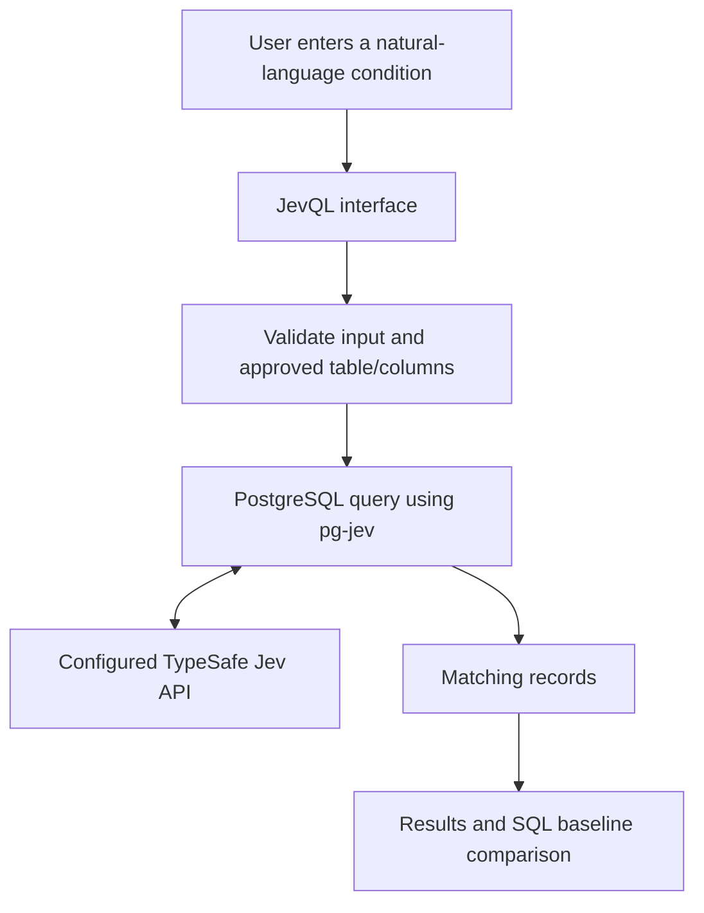

<div align="center">

# JevQL

### Search your data by meaning, not just keywords.

**Natural-language search for PostgreSQL, powered by the existing [`pg-jev`](https://github.com/realZachi/pg-jev) extension.**

[](#project-status)
[](https://www.postgresql.org/)
[](#ui-preview)
[](#team)

</div>

---

## The idea

Finding a record by an exact word is easy. Finding records that express the **same idea in different words** can be harder.

Imagine a support manager looking for unhappy customers. A search for `dissatisfied` may miss feedback such as:

> “I have contacted support three times and still have no reply.”

**JevQL** is a proposed web interface that aims to make this kind of search easier by letting people describe what they want to find in plain English, then evaluating records in PostgreSQL through the existing `pg-jev` extension.

> **Project status:** JevQL is a work in progress. The dashboard below is a design concept from Google Stitch, not a screenshot of a working search application. Live extension integration and benchmark results have not yet been verified.

## UI preview

<p align="center">
  
</p>

<p align="center"><em>Proposed UI concept — not yet implemented. Example records and visual scores are illustrative.</em></p>

## Why JevQL?

- **Search by intent:** express a search condition in everyday language.
- **Compare approaches:** evaluate semantic results against a simple SQL `ILIKE` baseline.
- **Stay in PostgreSQL:** use the existing `pg-jev` extension rather than inventing a replacement search engine.
- **Evaluate honestly:** measure relevance, latency, and API usage instead of assuming semantic search is always better.

## How it is intended to work



The application is responsible for the interface, input validation, approved-table controls, and result presentation. The `pg-jev` extension is intended to handle its documented semantic evaluation and API communication.

## Planned features

- Natural-language search over an approved PostgreSQL table.
- Structured result table for matching records.
- Comparison with a keyword-based SQL `ILIKE` baseline.
- Optional classification or scoring where supported by the installed extension.
- Execution, cache, and API statistics where the underlying system exposes them.
- Evaluation using labelled synthetic examples.

Features are planned until they are implemented and tested. Metrics must not be presented as measured results unless they have actually been collected.

## Technology

| Area | Planned technology |
|---|---|
| Database | PostgreSQL |
| Semantic evaluation | Existing [`pg-jev`](https://github.com/realZachi/pg-jev) extension |
| Extension runtime | PL/Python (`plpython3u`), subject to verified installation requirements |
| API | TypeSafe Jev API, configured according to official documentation |
| Initial UI | Streamlit or a lightweight web interface |
| Database access | Psycopg |
| Evaluation | Python tests and labelled synthetic records |

## Repository layout

```text
jevql-natural-language-search/
├── README.md
├── .gitignore
├── .env.example
├── LICENSE
├── app/
│   └── README.md
├── database/
│   ├── schema.sql
│   └── seed_data.sql
├── docs/
│   └── images/
│       └── jevql-dashboard.png
└── tests/
    └── README.md
```

## Getting started

This repository currently provides the project overview, proposed UI concept, and a small synthetic database example. It does **not** claim that the complete application or `pg-jev` integration is ready to run.

### 1. Clone the repository

```bash
git clone https://github.com/vortex-001/jevql-natural-language-search.git
cd jevql-natural-language-search
```

### 2. Review the sample database

Inspect `database/schema.sql` and `database/seed_data.sql`. The sample records are synthetic and intended for development and demonstration only.

### 3. Review the upstream extension

Before implementing live search, check the official project documentation and installation requirements:

- [Official website](https://pgjev.com)
- [Documentation](https://pgjev.com/docs)
- [Source repository](https://github.com/realZachi/pg-jev)

Verify PostgreSQL compatibility, PL/Python requirements, function signatures, API configuration, and security considerations for the exact version you install.

## Evaluation plan

JevQL should be evaluated against a simple baseline instead of assuming it is more accurate or faster.

1. Create a small set of synthetic feedback records.
2. Manually label which records should match each search condition.
3. Compare JevQL results with an `ILIKE` baseline.
4. Calculate precision and recall from labelled results.
5. Measure cold-cache and warm-cache latency separately.
6. Record API requests, cache statistics, and estimated cost only when those values are available.
7. Document the dataset size, environment, query, cache state, and repetitions.

No benchmark numbers are published here because the live search path has not yet been validated.

## Security and privacy

- Never commit real API keys, database passwords, or a real `.env` file.
- Use `.env.example` as a configuration template.
- Use synthetic records during development.
- Allowlist tables and searchable columns; do not execute unrestricted SQL from user input.
- Use least-privilege database credentials, parameterized queries, limits, and timeouts.
- Review which record text may be sent to the configured external API.
- Treat `plpython3u` as a security-sensitive, untrusted procedural language and follow the PostgreSQL/extension installation guidance.

## Team

**The Confluence**

- **Harsh Garg** — Team Leader
- Tushar
- Aryan Thakur
- Priyanka

Code Yudh Hackathon · Chandigarh University

## Roadmap

- [ ] Verify `pg-jev` requirements and supported PostgreSQL versions.
- [ ] Install and validate the extension independently.
- [ ] Connect JevQL to a local PostgreSQL demo database.
- [ ] Implement controlled natural-language search.
- [ ] Add the SQL baseline comparison.
- [ ] Add automated tests and labelled relevance evaluation.
- [ ] Record reproducible performance and API-usage results.

## Contributing

Suggestions and contributions are welcome. Please open an issue to discuss significant changes before submitting a pull request. Do not include credentials, private customer data, or unsupported performance claims.

## References

- [`pg-jev` official website](https://pgjev.com)
- [`pg-jev` documentation](https://pgjev.com/docs)
- [`pg-jev` source code](https://github.com/realZachi/pg-jev)
- [PostgreSQL documentation](https://www.postgresql.org/docs/)

---

<div align="center">

**JevQL · The Confluence**

*An honest, evaluation-first prototype for natural-language database search.*

</div>
